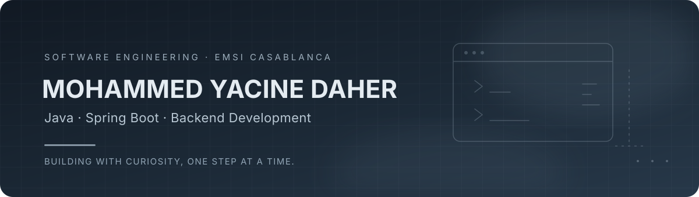

# Hi, I'm Yacine 👋

**Final-year software engineering student at EMSI Casablanca**, focused on **back-end development with Java & Spring Boot**, and getting into Cloud and DevOps.

🎯 **Looking for a 6-month end-of-studies internship (PFE) starting February 2027**, in Morocco or abroad, on back-end or full-stack Java projects.

💼 [LinkedIn](https://linkedin.com/in/mohammed-yacine-daher) · ✉️ [yacine.daher4@gmail.com](mailto:yacine.daher4@gmail.com)

---

## 💼 Experience

**Software engineering intern, ONDA — AIAC** (Nouaceur, Jul–Aug 2026)
Back-end developer in a Scrum team building **ResiAIAC**, a platform for managing the student residence of the Mohammed VI International Academy of Civil Aviation (admissions, room booking, maintenance requests).
I worked on the Spring Boot back end: JPA repositories, DTOs and MapStruct mappers, the service layer, REST controllers, unit tests (JUnit 5, Mockito), Redis caching and e-mail templates.

**Web development intern, PSB Maroc** (Jul–Aug 2025)
Built a company showcase platform (services, products, orders, contact) with React, Node.js and MongoDB.

## 🛠️ Featured projects

| Project | What it is | Stack |
|---|---|---|
| [**ResiAIAC**](https://github.com/YacineDaher/ResiAIAC) | Student residence management platform (internship, team project) | Java 17, Spring Boot, PostgreSQL, Redis, Keycloak, Docker, k3s, GitHub Actions |
| [**SubTracker**](https://github.com/YacineDaher/subtracker) | Desktop app to track subscriptions and spending, with family accounts and e-mail reminders | Java 21, JavaFX, JDBC, HikariCP, SQL Server, Maven |
| [**WearZone**](https://github.com/YacineDaher/WearZone) | E-commerce site with a customer storefront and an admin back office | C#, ASP.NET Core 8, EF Core, SQL Server, Identity |

## 🧰 Tech stack

**Used in real projects**

**Learning now:** Spring Cloud (Eureka, Gateway, Config), Kubernetes, CI/CD with GitHub Actions, Angular, Azure.

## 🌱 Right now

- Building **Mr. Coffee**, a point-of-sale and inventory management back end with Spring Boot (private for now).
- Practising microservices with Spring Cloud (service discovery, API gateway, centralized configuration).
- Getting more comfortable with Docker, Kubernetes and CI/CD pipelines.
- Improving my professional English.
